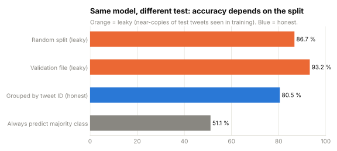
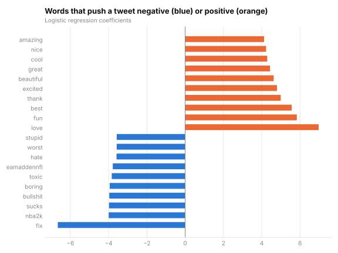

# Twitter Sentiment Analysis: finding the leak behind an 87 % accuracy

**Can a simple model tell positive from negative tweets, and how accurate is it on tweets it has never seen?**
TF-IDF + logistic regression on 43,013 labelled tweets, with an evaluation that does not cheat.



## Key results

| | |
|---|---|
| **Honest accuracy** | **80.5 %** on tweets the model has never seen (macro F1 0.80; always guessing the majority class: 51 %) |
| **Leakage found** | Each tweet appears **~6 times as paraphrased copies** under the same ID. A random split tests the model on near-copies of training tweets and reports **86.7 %** |
| **Validation file** | The dataset's own validation file gives **93.2 %**, but all of its tweet IDs also appear in the training file (59 % with identical text), so it cannot be used to measure real performance |
| **Shortcut learned** | Brand names (*nba2k*, *eamaddennfl*) are among the strongest "negative" words: the model partly learns which products people complain about, not how they express sentiment |

## Why this matters

A model evaluated on near-duplicates of its training data looks better than it is, and the gap only shows up after deployment. Here the fix is simple: split by **tweet ID** (`GroupShuffleSplit`) so that all versions of a tweet are either in training or in testing, never both. The same check applies to any dataset with repeated customers, sessions or devices.

| Evaluation | Accuracy | Macro F1 |
|---|---:|---:|
| Random split (leaky) | 86.7 % | 0.866 |
| Validation file (leaky) | 93.2 % | 0.932 |
| **Grouped by tweet ID (honest)** | **80.5 %** | **0.804** |
| Always predict the majority class | 51.1 % | – |



## Approach

1. **Check the data:** 74,682 rows, 12,447 unique tweet IDs (6 rows each), 686 missing texts, 5,190 exact duplicate texts.
2. **Keep Positive and Negative** tweets (43,013); drop rows with no text instead of filling them with an empty string.
3. **Model:** TF-IDF (5,000 terms, English stop words removed) + logistic regression in one scikit-learn `Pipeline`.
4. **Evaluate three ways** (random split, validation file, grouped split) and report the honest one.
5. **Inspect** the strongest words and misclassified tweets (sarcasm, negation, missing context).

## How to run

```bash
pip install -r requirements.txt
jupyter notebook sentiment_analysis.ipynb
```

The notebook runs top to bottom, saves tables to [`results/`](results/) and charts to [`images/`](images/). Trained models are not stored in the repo: training takes a few seconds.

## Next steps

- Remove entity names from the text, so the model learns sentiment instead of brands.
- Try character n-grams or a small pre-trained transformer for negation and sarcasm, evaluated with the same grouped split.

## Limitations

- Dataset labels are noisy, and the tweets cover a fixed set of games and tech brands.
- A bag-of-words model ignores word order, so sarcasm and negation spread over several words are hard for it.

## Data

[Twitter Entity Sentiment Analysis](https://www.kaggle.com/datasets/jp797498e/twitter-entity-sentiment-analysis) (Kaggle).

---

**Author:** Sachini Hewahattage · [LinkedIn](https://www.linkedin.com/in/sachini-hewahattage) · [GitHub](https://github.com/Sachinisand)
